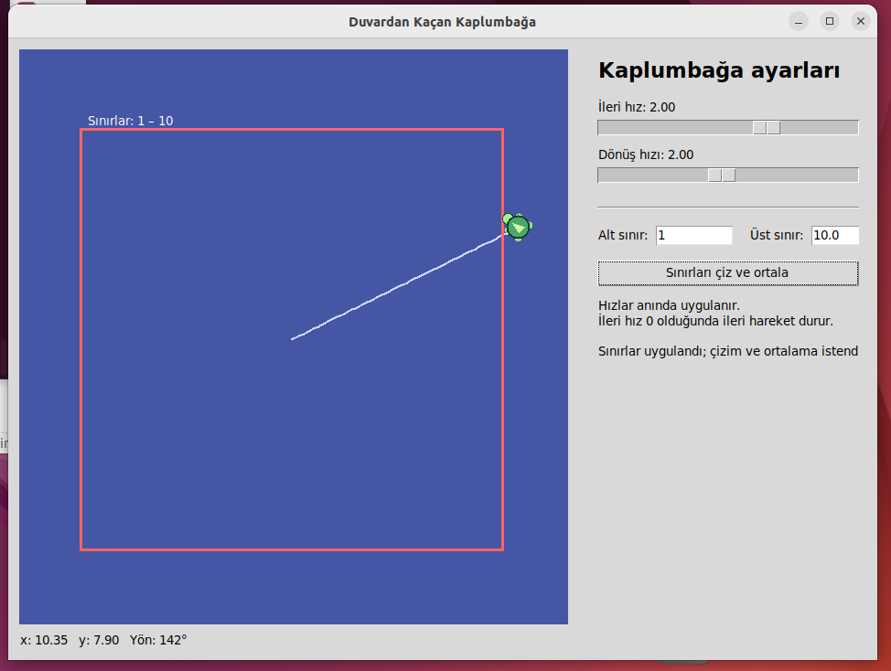
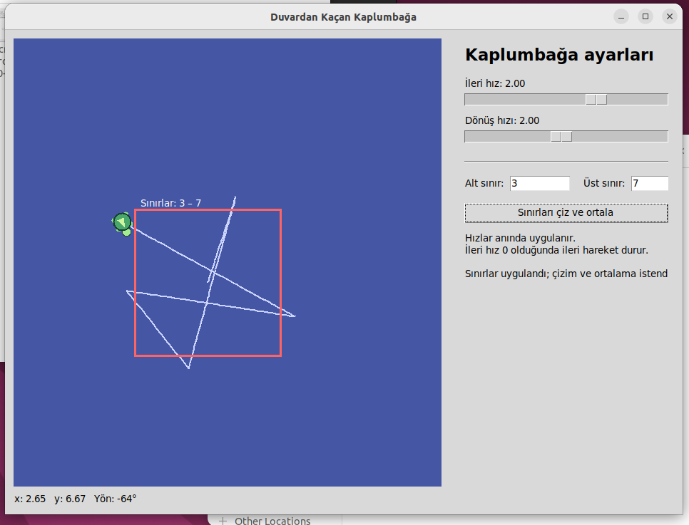
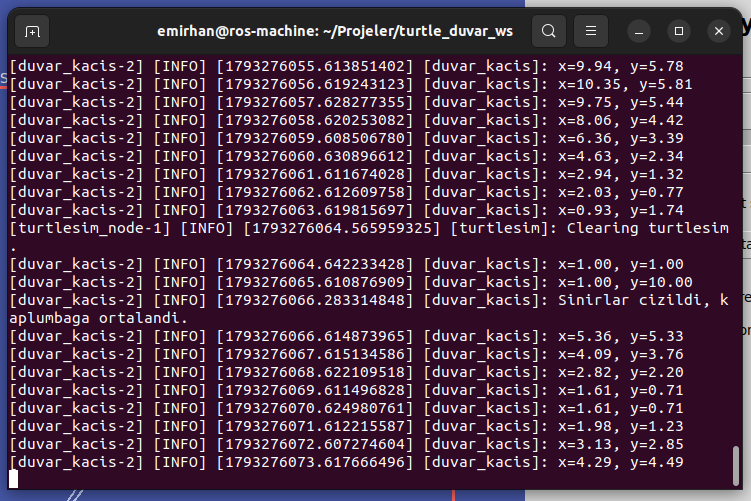

# Duvardan Kaçan Kaplumbağa

**ROS 2 Humble · Python · Turtlesim**

Bu proje, turtlesim ortamındaki kaplumbağanın belirlenen sınırlara ulaştığında yön değiştirerek hareketine devam etmesini sağlayan bir ROS 2 uygulamasıdır. Kaplumbağanın konumu `/turtle1/pose` konusundan alınır; hareket komutları `/turtle1/cmd_vel` konusuna yayınlanır.

Kaplumbağa sınır eşiğini aştığında ileri hareketini durdurur. Geliş yönünün duvara göre yansımasına rastgele bir açısal sapma eklenir ve yakın duvarlardan uzaklaşan bir yön seçilir. Dönüş tamamlandığında kaplumbağa yeniden ilerler. Böylece sürekli aynı hat üzerinde gidip gelmek yerine farklı rotalar izler.

## Özellikler

- Konum ve yön bilgisini ROS 2 aboneliğiyle alma.
- `geometry_msgs/msg/Twist` mesajlarıyla hareket kontrolü.
- x ve y değerlerini saniyede bir `get_logger().info()` ile terminale yazdırma.
- İleri hızı, dönüş hızı ve sınırları parametrelerle ayarlama.
- Hareket alanı ve kontrol panelini tek pencerede gösterme.
- Hızları uygulama çalışırken sürgülerle değiştirme.
- Alt ve üst sınırları kırmızı bir çerçeveyle gösterme.
- Sınırlar uygulandığında hareket izlerini temizleme ve kaplumbağayı yeni alanın merkezine taşıma.
- Simülatörü ve kontrol düğümünü tek launch komutuyla başlatma.

## Kullanılan teknolojiler

| Bileşen | Kullanım amacı |
|---|---|
| ROS 2 Humble | Düğüm, konu, servis ve parametre yönetimi |
| Python 3 / rclpy | Kontrol düğümünün geliştirilmesi |
| turtlesim | Kaplumbağanın hareket simülasyonu |
| geometry_msgs | Hız komutlarının iletilmesi |
| Tkinter | Kontrol paneli ve hareket alanının gösterimi |
| colcon / ament_python | Paketin derlenmesi ve kurulması |

## Gereksinimler

Grafik masaüstü oturumuna sahip Ubuntu ve kurulu ROS 2 Humble gereklidir. ROS 2 kurulumundan sonra ek paketler aşağıdaki komutlarla yüklenebilir:

```bash
source /opt/ros/humble/setup.bash
sudo apt update
sudo apt install ros-humble-turtlesim python3-tk python3-colcon-common-extensions
```

## Kurulum ve derleme

GitHub'daki **Ros2_Turtle** deposunu **Code → Download ZIP** seçeneğiyle indirin ve arşivi çıkarın. İçinde `package.xml`, `setup.py` ve `README.md` bulunan ana klasörü `turtle_duvar_py` olarak adlandırın.

Çalışma alanını oluşturun:

```bash
mkdir -p ~/Projeler/turtle_duvar_ws/src
```

Hazırladığınız `turtle_duvar_py` klasörünü çalışma alanının `src` klasörüne kopyalayın. Paket tanım dosyasının yolu şu olmalıdır:

```text
~/Projeler/turtle_duvar_ws/src/turtle_duvar_py/package.xml
```

Ardından paketi derleyin:

```bash
source /opt/ros/humble/setup.bash
cd ~/Projeler/turtle_duvar_ws
colcon build --symlink-install --packages-select turtle_duvar_py
source install/setup.bash
```

> GitHub deposunun adı `Ros2_Turtle`, ROS 2 paketinin adı ise `turtle_duvar_py` olarak tanımlıdır.

## Çalıştırma

```bash
source /opt/ros/humble/setup.bash
source ~/Projeler/turtle_duvar_ws/install/setup.bash
ros2 launch turtle_duvar_py duvar.launch.py
```

Bu komut, turtlesim simülatörünü arka planda ve kontrol arayüzünü görünür olarak başlatır. Hareket alanı ile ayarlar aynı pencerede yer alır. Arayüzdeki kaplumbağa simgesi, `/turtle1/pose` konusundan alınan gerçek simülasyon konumu ve yönü kullanılarak çizilir.

Uygulama, pencere kapatılarak veya terminalde `Ctrl+C` tuşlarına basılarak sonlandırılabilir.

## Arayüzün kullanımı

1. **İleri hız** sürgüsüyle kaplumbağanın ilerleme hızını değiştirin.
2. **Dönüş hızı** sürgüsüyle yön değiştirme hızını ayarlayın.
3. **Alt sınır** ve **Üst sınır** alanlarına yeni değerleri girin.
4. **Sınırları çiz ve ortala** düğmesine basın.

Hız değişiklikleri hareket sırasında uygulanır. İleri hızının `0` yapılması ileri hareketi durdurur; devam eden yön değiştirme tamamlanabilir.

Sınırlar uygulandığında eski hareket izleri temizlenir, yeni kırmızı çerçeve oluşturulur ve kaplumbağa yeni alanın merkezine taşınır. x ve y eksenlerinde aynı sınırlar kullanıldığı için alan kare biçimindedir.

Merkez koordinatı her iki eksen için `(alt_sinir + ust_sinir) / 2` olarak hesaplanır. Örneğin alt sınır `3`, üst sınır `7` olduğunda kaplumbağa `(5, 5)` konumuna taşınır.

## Parametreler

| Parametre | Varsayılan değer | Geçerli aralık | Açıklama |
|---|---:|---|---|
| `ileri_hiz` | `2.0` | `0.0–3.0` | İleri hareket hızı |
| `donus_hiz` | `2.0` | `0.2–4.0` | En yüksek açısal hız, rad/s |
| `alt_sinir` | `1.0` | `0 < alt_sinir < ust_sinir` | x ve y için alt eşik |
| `ust_sinir` | `10.0` | `alt_sinir < ust_sinir < 11` | x ve y için üst eşik |

Geçersiz sınır değerleri uygulama tarafından reddedilir ve önceki parametreler korunur.

Başlangıç değerleri launch komutuna da eklenebilir:

```bash
ros2 launch turtle_duvar_py duvar.launch.py \
  ileri_hiz:=1.5 \
  donus_hiz:=2.5 \
  alt_sinir:=2.0 \
  ust_sinir:=9.0
```

## ROS 2 bağlantıları

Kontrol düğümünün adı `duvar_kacis` olarak tanımlanmıştır.

| Bağlantı | Konu / servis adı | Mesaj / servis türü |
|---|---|---|
| Abone | `/turtle1/pose` | `turtlesim/msg/Pose` |
| Yayıncı | `/turtle1/cmd_vel` | `geometry_msgs/msg/Twist` |
| Servis istemcisi | `/turtle1/teleport_absolute` | `turtlesim/srv/TeleportAbsolute` |
| Servis istemcisi | `/turtle1/set_pen` | `turtlesim/srv/SetPen` |
| Servis istemcisi | `/clear` | `std_srvs/srv/Empty` |

Hareket kontrolü `0.05` saniyelik zamanlayıcıyla yürütülür. Konum bilgisi ayrı bir zamanlayıcıyla saniyede bir terminale yazdırılır.

## Dosya yapısı

Aşağıdaki yapı GitHub deposunun ana dizinini göstermektedir:

```text
Ros2_Turtle/
├── README.md
├── package.xml
├── setup.py
├── setup.cfg
├── launch/
│   └── duvar.launch.py
├── resource/
│   └── turtle_duvar_py
├── screenshots/
│   ├── 01_tek_pencere.png
│   ├── 02_yeni_sinirlar.png
│   └── 03_konum_loglari.png
└── turtle_duvar_py/
    ├── __init__.py
    └── duvar_kacis.py
```

## Doğrulama adımları

| İşlem | Beklenen davranış |
|---|---|
| Uygulamayı başlatma | Tek pencere, kontrol paneli ve kırmızı sınır çerçevesi açılır. |
| Kaplumbağanın sınır eşiğini aşması | İleri hareket durur; kaplumbağa içeri yönelen rastgele bir açıya döner ve yeniden ilerler. |
| Hız sürgülerini değiştirme | Hareket ve dönüş hızları yeniden başlatma gerektirmeden güncellenir. |
| Sınırları `3` ve `7` olarak uygulama | Çerçeve yenilenir; kaplumbağa `(5, 5)` konumuna taşınır. |
| Alt sınırı üst sınırdan büyük girme | İşlem reddedilir ve önceki sınırlar korunur. |
| Terminal çıktısını izleme | x ve y konumu saniyede bir yazdırılır. |

## Ekran görüntüleri

### Hareket alanı ve kontrol paneli



### Sınırların değiştirilmesi



### Konum logları


